# 登录后界面视觉与交互优化方案

> 参考对象：[Modrinth / Discover / Mods](https://modrinth.com/discover/mods)
> 技术栈：Vue 3.5 + Vite 6 + TypeScript + Pinia + vue-router，手写 CSS，无 UI 组件库
> 范围：登录后的 `/discover`、`/skills`、`/skills/:id`、`/chat`，新增公开社区 `/community`、`/community/:id`，以及全部登录后弹窗和空状态
> 已确认决策：**浅色主题 + 品牌蓝**；保留 Logo、吉祥物、品牌名；统一顶部导航；聊天保留三栏；全部业务逻辑不变
> 社区试验策略：先做 **AI 整理指南 + 可运行配方 + AI 首答**，不开放用户发帖，避免冷启动空城

---

## 1. 参考页设计要素归纳

参考站当前的 discover 页不是“白底卡片”风格，而是深色分层 + 高饱和品牌绿 + 大圆角。核对到的核心 token：

| 维度 | 参考站 token | 本项目翻译 |
| --- | --- | --- |
| 页面底色 | `#16181c` | `#f3f4f6` |
| 卡片/浮层 | `#27292e` / `#34363c` | `#ffffff` / `#f8fafc` |
| 品牌色 | `#1bd96a`（深色主题） | 品牌蓝 `#12b7f5`，CTA 用 `#0a76b8` |
| 正文 / 次级 | `#b0bac5` / `#96a2b0` | `#1a202c` / `#64748b` |
| 卡片圆角 | `16px` | `16px` |
| 按钮圆角 | `12px`，大按钮 `16px` | `12px`，大按钮 `16px` |
| 字重 | 500 / 600 / 800 | 500 / 600 / 700 / 800 |
| 字体 | Inter | Inter + PingFang SC / Microsoft YaHei |

可复用的结构特征：

1. **顶部导航**：品牌在左、导航居中偏左、搜索在中间、用户区在右；当前项用底部 2px 品牌色下划线。
2. **发现页布局**：左侧筛选栏 + 右侧结果区；筛选栏是轻量文本列表，不是重卡片。
3. **结果区**：支持 grid / list 双视图；卡片是“图标 + 标题 + 作者 + 描述 + 胶囊标签 + 统计 + 主操作”。
4. **卡片交互**：hover 只做 1px 边框加深 + 极轻阴影 + 1px 上移，不用大投影。
5. **标签**：小号胶囊，低对比底色，不使用高饱和背景。
6. **主操作**：绿色/品牌色实心按钮，文字与背景对比明确；次要操作是白底描边按钮。
7. **加载与空状态**：骨架屏保持与卡片同尺寸；空状态用插画 + 一句解释 + 一个出口按钮。

不可直接迁移的部分：

- 参考站的 `Environment / Loader / Version` 是 Minecraft 模组特有维度，本项目数据只有分类、语言、Star、收藏数；对应改造成“分类 + 语言 + Star 排序”。
- 参考站的 `Install` 会打开版本选择器；本项目是“收藏 GitHub 仓库”的单步操作，因此不引入版本弹窗，保留一键收藏语义。
- 参考站的 64px 方形项目图标来自项目上传资源；本项目使用 GitHub owner 头像，尺寸降为 42/48px，并用首字母色块兜底。
- 参考站的深色底 + 绿色品牌与本次“浅色 + 品牌蓝”的决策冲突；保留的是其**层级、圆角、密度、标签、交互节奏**，而不是颜色。

---

## 2. 改造前的差距

| 问题 | 具体表现 | 处理 |
| --- | --- | --- |
| 两套壳 | 发现/广场用 topbar，聊天用左侧 64px rail | 新增 `AppTopbar`，四页共用；聊天模式切换收进会话栏 |
| 层级弱 | 白底卡片 + 白底页面，靠边框区分 | 页面 `#f3f4f6`、卡片纯白、浮层 `#f8fafc`，用明度分层 |
| 圆角混乱 | 6/7/8/9/10/12/13/14/18px 混用 | 统一 8/12/16/20 + 胶囊 |
| 字号混乱 | 标题 13/15/16/17px 混用 | 32/24/20/16/14.5/13.5/12.5/11 八级 |
| 阴影两套 | 轻阴影与 32px 大阴影混用 | `shadow-sm` / `shadow-md` / `shadow-lg` 三级 |
| 状态缺失 | 部分按钮无 hover/active/focus-visible/disabled | 全局补齐，`:focus-visible` 统一 2px 品牌色 outline |
| 详情页未统一 | 自带 topbar、按钮圆角 9px | 接入 `AppTopbar`，hero + 两栏 + sticky 侧栏 |
| 聊天页未统一 | 深色 rail、浅色面板、弹窗 z-index 不一致 | 顶部导航 + 三栏 + 统一卡片/气泡/输入框 |
| 移动端聊天无返回 | 侧栏与消息区互相挤压 | 760px 以下侧栏/消息区互斥切换，ChatPanel 增加返回按钮 |

---

## 3. 全局样式规范

### 3.1 色彩

```css
:root {
  /* 品牌 */
  --color-primary: #12b7f5;        /* 品牌识别、焦点、选中态 */
  --color-primary-strong: #0a76b8; /* CTA、链接文字，满足白底对比度 */
  --color-primary-dark: #08639c;   /* CTA hover */
  --color-primary-soft: rgba(18, 183, 245, 0.12);
  --color-primary-softer: rgba(18, 183, 245, 0.06);

  /* 语义 */
  --color-danger: #cb2245;
  --color-success: #00a76b;
  --color-warning: #e08325;

  /* 中性 */
  --color-bg: #f3f4f6;
  --color-bg-subtle: #f8fafc;
  --color-panel: #ffffff;
  --color-border: #e2e8f0;
  --color-border-strong: #cbd5e1;
  --color-divider: #edf1f5;
  --color-text: #1a202c;
  --color-text-secondary: #4a5568;
  --color-text-muted: #64748b;
}
```

规则：

- 品牌蓝只用于**识别与选中**；可点击文字和大面积 CTA 使用深一档的 `--color-primary-strong`，避免白字在 `#12b7f5` 上对比不足。
- 绿色只表达成功/在线，不再作为装饰色。
- 页面底、卡片、浮层必须是三级明度：`bg` → `panel` → `bg-subtle`。
- 正文不使用纯黑；标题 `#1a202c`，正文 `#4a5568`，辅助 `#64748b`。

### 3.2 字体层级

| Token | 字号 | 字重 | 用途 |
| --- | --- | --- | --- |
| `--text-2xl` | 32px | 800 | 页面主标题（发现、广场） |
| `--text-xl` | 24px | 800 | 详情页 title |
| `--text-lg` | 20px | 700 | 区块标题 |
| `--text-md` | 16px | 600 | 卡片/列表主标题 |
| `--text-base` | 14px | 400/500 | 正文、输入 |
| `--text-sm` | 12.5px | 400/500 | 卡片描述、辅助 |
| `--text-xs` | 11px | 500 | 标签、统计、eyebrow |

- 标题统一 `letter-spacing: -0.02em`；eyebrow 统一大写 + `1.2–2.6px` 字距。
- 行高：标题 1.15–1.35，正文 1.6–1.7。

### 3.3 间距与栅格

- 4px 基准：`4 / 8 / 12 / 16 / 20 / 24 / 32 / 40 / 48`。
- 页面容器：`max-width: 1280px`，左右 `24px`；移动端 `16px`。
- 区块间距：`32px`；卡片内边距 `16px`；卡片网格 `14px`。
- 顶部导航高度 `64px`；聊天三栏：`300px + 1fr + 300px`。
- 广场筛选栏 `232px`，与结果区间距 `32px`。

### 3.4 圆角与阴影

| Token | 值 | 用途 |
| --- | --- | --- |
| `--radius-sm` | 8px | 小按钮、输入内元素 |
| `--radius-md` | 12px | 标准按钮、输入框、分类卡 |
| `--radius-lg` | 16px | 技能卡、页面卡片、弹窗 |
| `--radius-xl` | 20px | 欢迎区 |
| `--radius-pill` | 999px | 标签、筛选 chip |

- `--shadow-sm`：`0 1px 2px rgba(16,24,40,.04)`，默认卡片。
- `--shadow-md`：`0 8px 24px rgba(16,24,40,.08)`，浮层/Toast。
- `--shadow-lg`：`0 18px 48px rgba(16,24,40,.12)`，用户菜单/大弹窗。
- 卡片 hover 不升级到大阴影，只到 `0 6px 18px rgba(16,24,40,.07)`。

### 3.5 组件状态

| 状态 | 规范 |
| --- | --- |
| Default | 白底、1px `--color-border`、文字 `--color-text-secondary` |
| Hover | 边框到 `--color-border-strong` 或品牌色 55% 透明；背景 `--color-bg-subtle` |
| Active | 背景再深一档；不改变布局尺寸 |
| Focus-visible | 2px 品牌色 outline，offset 2px；输入框用 3px soft ring |
| Disabled | `opacity: .55`，`cursor: not-allowed` |
| Loading | 骨架屏与卡片同高；按钮文案改为“搜索中…/处理中…” |
| Selected | `--color-primary-soft` 背景 + `--color-primary-strong` 文字 + 600 字重 |

全局过渡：`160ms ease`；尊重 `prefers-reduced-motion`。

### 3.6 响应式断点

| 断点 | 行为 |
| --- | --- |
| `1200px` | 聊天隐藏右侧信息栏，保留会话栏 + 消息区 |
| `1080px` | 广场筛选栏收窄到 200px；卡片最小宽度 260px |
| `900px` | 广场隐藏左侧筛选栏，改用顶部 tabs + 横向分类 chips |
| `860px` | 顶栏搜索隐藏；广场显示移动端搜索行 |
| `760px` | 聊天侧栏/消息区互斥；ChatPanel 显示返回按钮 |
| `620px` | 顶栏只留 Logo；发现页分类 2 列；卡片 1 列 |

---

## 4. 页面改造说明

### 4.1 公共壳：`AppTopbar`

文件：`frontend/src/components/AppTopbar.vue`

- 高度 64px，白底 + 轻微 blur，底部 1px 边框。
- 左：Logo + 品牌名 + `AI SKILL WORKSHOP` 副标。
- 中左：发现 / 技能广场 / 聊天；当前项底部 2px 品牌色。
- 中：页面搜索（发现、广场显示；详情、聊天隐藏）。
- 右：头像 + 昵称 + 下拉菜单（个人资料、修改密码、开启桌面通知、退出登录）。
- 个人资料与修改密码弹窗由顶栏统一托管，因此**所有登录后页面**都有这两个入口。
- 退出登录仍由页面处理：顶栏只 emit，页面负责 `ws.disconnect()` / `chat.reset()` / `auth.clearSession()`。

```vue
<AppTopbar
  v-model="keyword"
  active="skills"
  :search-disabled="loading"
  search-placeholder="搜索 AI 技能，例如 ai video generation"
  @input="onKeywordInput"
  @search="submitSearch()"
  @logout="handleLogout"
/>
```

### 4.2 发现页 `/discover`

文件：`frontend/src/views/DiscoverView.vue`

- 去掉大面积蓝色渐变 hero，改为白色欢迎卡 + 右角吉祥物 + 统计数字。
- 分类从 6 个大卡片改为 4 列分类卡，hover 出现箭头与品牌色边框。
- 热门推荐改为 3–4 列技能卡，统一使用 `SkillCard`。
- “我的收藏”改为横向滚动的小卡，保留原有跳转。
- 搜索、分类跳转、收藏/取消收藏逻辑不变；卡片点击从 `?open=` 改为直接 `/skills/:id`（旧 query 仍兼容）。

### 4.3 技能广场 `/skills`

文件：`frontend/src/views/SkillsView.vue`

- 左侧 232px 筛选栏：浏览（推荐/已安装）、分类列表、GitHub 配额提示。
- 结果区：标题 + 结果数 + 排序提示 + grid/list 切换。
- 默认 grid，使用 `SkillCard`；list 使用 `SkillRow`。
- 加载态改为 6 个同尺寸骨架卡；空态保留大肥鱼插画。
- 分类选中、搜索回车、加载更多、收藏回滚、`?q=` / `?open=` 兼容全部保留。
- 修复“搜索后点击当前 tab 不生效”的旧边界：`switchTab` 在 `searched` 为 true 时也允许重置。

### 4.4 技能详情 `/skills/:id`

文件：`frontend/src/views/SkillDetailView.vue`

- 接入 `AppTopbar`，移除页面自带 topbar。
- 面包屑：返回按钮 + “技能广场 / owner/name”。
- Hero：64px 头像、24px 标题、描述、指标胶囊、topics、右侧收藏/GitHub 操作。
- **大肥鱼总结卡**：进入详情后自动读取当前技能 README 并生成总结；先写一段按该 README 具体内容变化的“大肥鱼点评”，再固定结构“一句话 / 它能做什么 / 适合谁 / 怎么开始 / 注意”；展示模型标识、生成时间、降级提示和“重新总结”。
- 两栏：README 主区 + 300px sticky 侧栏（仓库信息、获取方式）。
- README 继续以 `pre` 原文展示，避免引入 Markdown 渲染器改变现有行为。
- 大肥鱼总结接口：`GET /api/skills/{id}/summary?refresh=false`，默认缓存 30 分钟；首次调用本地模型可能耗时 20–60 秒，前端超时放宽到 150 秒。
- 模型不可用时返回规则摘要（`aiGenerated=false` + `notice`），不伪装成 AI 输出。

### 4.5 聊天 `/chat`

文件：`frontend/src/views/ChatView.vue`、`SidePanel.vue`、`ChatPanel.vue`、`ConversationInfo.vue`

- 顶部统一 `AppTopbar`；移除左侧 `AppNavRail`。
- 内容区三栏：会话栏 300px + 消息区 `1fr` + 会话信息栏 300px。
- 会话栏顶部增加“消息 / 联系人”分段 tabs，原 rail 的未读/待处理角标迁移到这里。
- 右侧信息栏使用已有 `conversation.peer` / `conversation.members` 数据：单聊显示签名与在线状态，群聊显示成员宫格和“群成员管理”。
- `GroupMembersModal` 从 `ChatPanel` 提升到 `ChatView`，由 ChatPanel 与信息栏共同触发，避免两个弹窗实例。
- `<1200px` 隐藏信息栏；`<760px` 会话栏与消息区互斥，ChatPanel 增加返回按钮。
- 消息发送、附件、撤回、未读、WS、群管理、好友申请全部沿用原逻辑。

### 4.6 弹窗、空状态与 Toast

- 所有弹窗统一：遮罩 `rgba(17,24,39,.42)`、卡片 16px 圆角、`--shadow-lg`、`z-index: 1200`。
- `ProfileEditModal`、`GroupCreateModal`、`GroupMembersModal`、`ImagePreview` 原本已 Teleport；`ChangePasswordModal` 本次补上 Teleport，避免被顶栏 `backdrop-filter` 限制成“只在顶栏高度内显示”。
- Toast 统一 12px 圆角 + `--shadow-md`。
- 空状态使用 `empty-block` 类：插画 + 标题 + 一句解释 + 一个主/次按钮。

---

## 5. 代码改动清单

| 文件 | 类型 | 说明 |
| --- | --- | --- |
| `frontend/src/styles/main.css` | 重构 | 全局 token、按钮/输入/标签/卡片/骨架/空状态、焦点态、登录页隔离 |
| `frontend/src/components/AppTopbar.vue` | 新增 | 统一顶部导航、搜索、用户菜单、资料/改密弹窗 |
| `frontend/src/components/SkillCard.vue` | 新增 | 发现/广场共用的技能卡 |
| `frontend/src/components/SkillRow.vue` | 新增 | 广场列表视图 |
| `frontend/src/components/ConversationInfo.vue` | 新增 | 聊天右侧会话信息栏 |
| `frontend/src/views/DiscoverView.vue` | 重构 | 欢迎区、分类、热门、收藏 |
| `frontend/src/views/SkillsView.vue` | 重构 | 筛选栏、grid/list、骨架、空态；删除不可达的旧详情弹窗 |
| `frontend/src/views/SkillDetailView.vue` | 重构 | 统一 topbar、hero、两栏、sticky 侧栏 |
| `frontend/src/views/ChatView.vue` | 重构 | 顶栏 + 三栏、信息栏、移动端互斥、成员弹窗提升 |
| `frontend/src/components/SidePanel.vue` | 改造 | 消息/联系人 tabs、搜索、未读角标 |
| `frontend/src/components/ChatPanel.vue` | 改造 | 移动端返回、成员弹窗改 emit、头部/消息区样式 |
| `frontend/src/components/ChatInput.vue` | 改造 | 输入区、发送按钮、间距 |
| `frontend/src/components/MessageBubble.vue` | 改造 | 气泡圆角/边框/品牌色、系统消息 |
| `frontend/src/components/ConversationList.vue` | 改造 | 会话选中态、字号、圆角 |
| `frontend/src/components/ContactList.vue` | 改造 | hover、图标色、分组标签 |
| `frontend/src/components/ChangePasswordModal.vue` | 修复 | Teleport、z-index、CTA 颜色、输入框圆角 |
| `frontend/src/components/ProfileEditModal.vue` | 改造 | 卡片/输入圆角 |
| `frontend/src/components/GroupCreateModal.vue` | 改造 | 卡片/输入圆角、分割线 |
| `frontend/src/components/GroupMembersModal.vue` | 改造 | 卡片/输入圆角、分割线 |
| `frontend/src/components/AddFriendPanel.vue` | 改造 | 分割线、状态胶囊 |
| `frontend/src/components/FriendRequestsPanel.vue` | 改造 | 分割线、状态胶囊 |
| `frontend/src/components/ToastHost.vue` | 改造 | 圆角/阴影 |
| `frontend/src/utils/format.ts` | 扩展 | 新增 `formatCompact` |
| `frontend/src/components/AppNavRail.vue` | 删除 | 聊天不再使用左 rail；功能迁移到顶栏 + 会话栏 tabs |

没有改动：路由语义、Pinia store、API 封装、WS 事件、鉴权、上传、下载、搜索配额策略。

---

## 6. 验证

- `pnpm build`：`vue-tsc --noEmit` + Vite 构建通过（184 modules）。
- 用系统 Chrome 以 mock 数据渲染四个页面，覆盖 1440 / 1280 / 390 三档宽度，检查了：
  - 发现页滚动到底部的“我的收藏”；
  - 广场 grid/list 双视图、筛选栏、移动端搜索；
  - 详情页 README 两栏与 sticky 侧栏；
  - 聊天空态、会话态、右侧信息栏、移动端返回；
  - 用户菜单、资料弹窗、修改密码弹窗的层级与 Teleport。
- 预览图：`docs/ui-preview/`（mock 数据，仅用于布局验收）。
- 发现并修复：测试 Chrome 不支持 `100dvh`（`CSS.supports` 为 false），所有页面已加 `100vh` 兜底；否则聊天页会只占内容高度。
- mock 预览中唯一的 console error 是 WS 握手失败，属于无后端时的预期错误；真实环境由 `ws.connect(token)` 建立。

### 部署提示（8080）

`http://10.6.9.182:8080` 由 Docker 的 `weliao-frontend` 容器提供，不是本地 Vite。只在宿主机执行 `pnpm build` 不会更新容器；发布前端改动需要重建镜像：

```bash
cd deploy
docker compose build frontend
docker compose up -d --no-deps frontend
```

或在仓库根目录执行 `.\start.cmd -Rebuild`（会重建全部服务，较慢）。`frontend/nginx/default.conf` 已为 `index.html` 加 `Cache-Control: no-store`，避免发布后浏览器继续引用旧 hash 资源；`/assets/` 仍保持 immutable 长缓存。

### 验收预览

| 页面 | 桌面 |
| --- | --- |
| 发现 | 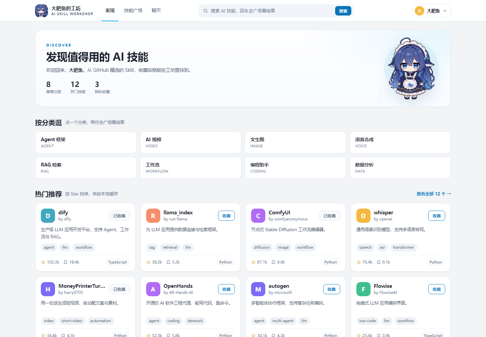 |
| 技能广场（Grid） | 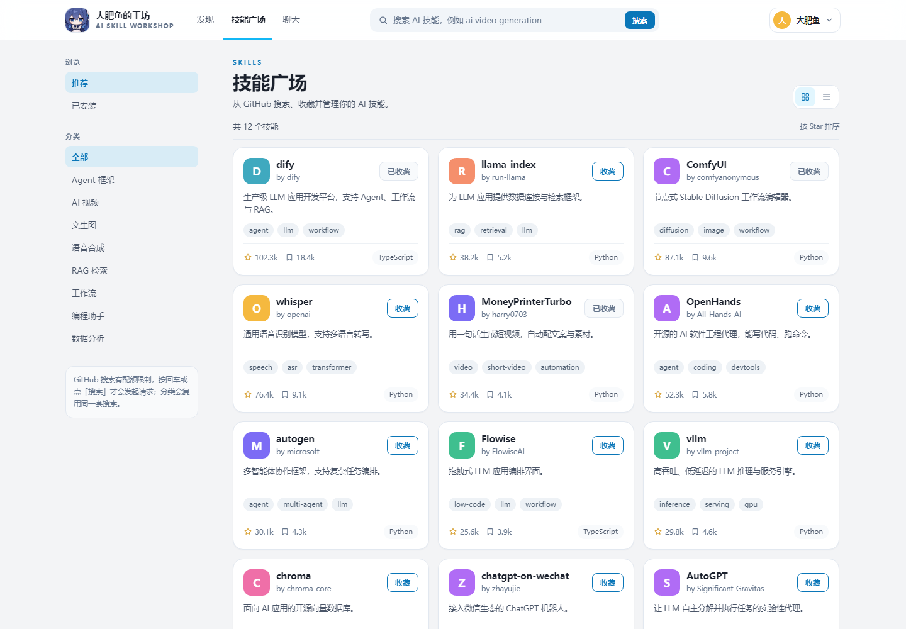 |
| 技能广场（List） | 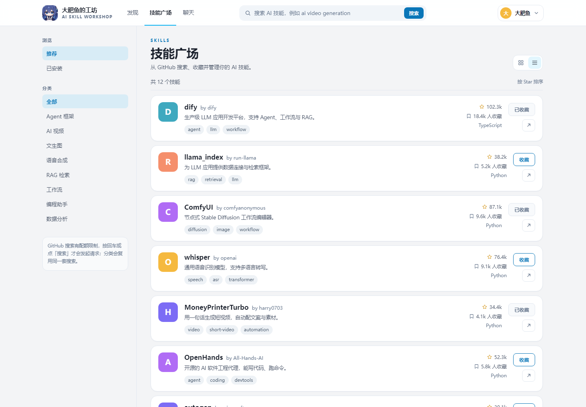 |
| 技能详情 | 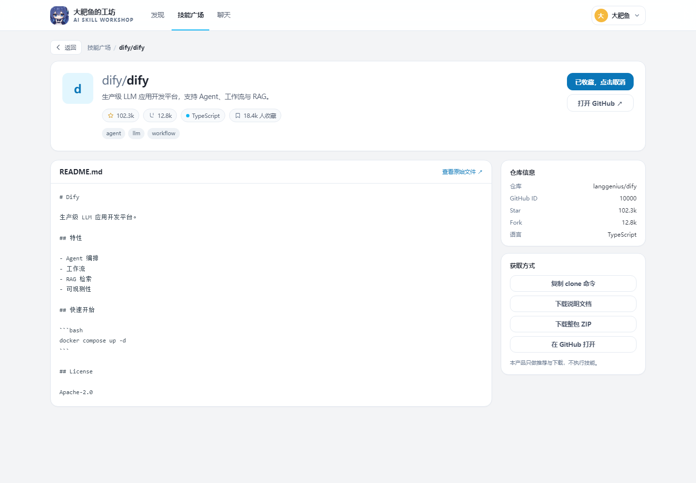 |
| 聊天 | 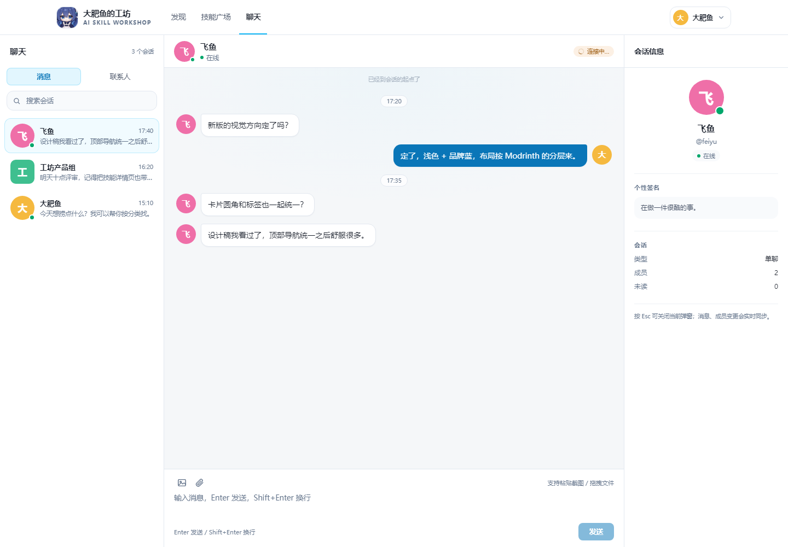 |

| 移动端（390px） |  |
| --- | --- |
| 发现 | 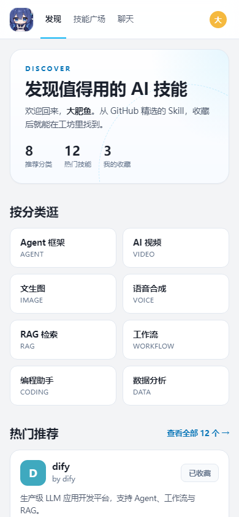 |
| 技能广场 | 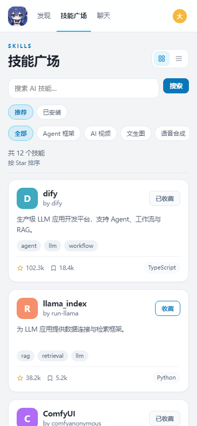 |
| 聊天 | 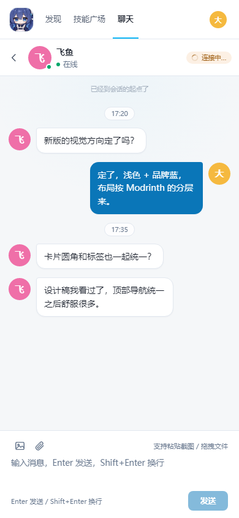 |

> 预览使用 mock 数据，仅用于验证布局、密度、断点与交互层级；真实数据下卡片数量与文案会不同。

---

## 7. 已确认决策与剩余风险

以下 4 项已确认（2026-10-30），按当前实现定稿：

1. **CTA 使用 `#0a76b8`**：确认。品牌蓝 `#12b7f5` 继续用于识别/选中/焦点，CTA 用深一档蓝保证白字对比度。
2. **聊天右侧信息栏**：确认保留。只读取已有 `peer/members` 数据，不新增接口；单聊显示签名与在线状态，群聊显示成员宫格与“群成员管理”。
3. **移动端聊天互斥**：确认。`<=760px` 时会话列表与消息区互斥切换，ChatPanel 提供返回按钮；App / 内嵌 WebView 复用同一套响应式断点，390px 已验证。若后续要求窄屏同时显示三栏，需要回退该断点规则。
4. **删除 `AppNavRail.vue`**：确认。聊天不再挂载左 rail，功能迁移到顶栏 + 会话栏 tabs；若其他分支仍引用该文件，合并时按新结构改引用。

剩余风险（已知悉，不需要再决策）：

- 登录页已用 `.login-page` 隔离旧文本色/边框/输入框圆角，登录页自身未做视觉改版。
- 全局 token 仍会影响未登录的 404 页；404 属公共页，不在本次范围。若要求严格隔离，可把登录后 token 收进 `.app-theme` 包裹层。
- mock 预览中的 WS 握手错误属于无后端时的预期错误；真实环境由 `ws.connect(token)` 建立连接。
- 若 App WebView 需要底部安全区/PWA 安装体验，可在此基础上单独补 `safe-area-inset-*` 与 manifest，不影响当前 Web 布局。

---

## 8. 新增页面接入指南

1. 页面根节点使用：

```vue
<div class="your-page">
  <AppTopbar active="discover" @logout="handleLogout" />
  <main class="page-scroll">
    <div class="page-container">...</div>
  </main>
</div>
```

```css
.your-page {
  display: flex;
  flex-direction: column;
  height: 100vh;
  height: 100dvh; /* 旧 Chrome 用上一行兜底 */
  overflow: hidden;
  background: var(--color-bg);
}
```

2. 卡片直接复用 `<SkillCard>` / `<SkillRow>`，不要在新页面重新写一套卡片样式。
3. 标题、正文、辅助文字只使用 `--text-*` 与 `--color-text*`，不要写死字号/颜色。
4. 主按钮用 `.btn.btn-primary`，次按钮用 `.btn`，危险操作用 `.btn.btn-danger`；胶囊标签用 `.tag`。
5. 弹窗必须 `Teleport to="body"`，遮罩 `z-index: 1200`，卡片 `--radius-lg`。
6. 新页面若需要三栏/侧栏，优先复用 `SidePanel`、`ConversationInfo` 的宽度与断点，不要另起一套。

---

## 9. 社区模块（新增）

### 9.1 定位

试验期没有真实帖子，先不做“空论坛”，而是做**官方 AI 指南 + 配方 + AI 首答**：

- 指南负责解释基础问题。
- 配方负责“照着做就能出结果”，是浅度用户的主入口。
- AI 首答负责接住用户的具体问题；没解决的记录进人工补充队列。
- 现有发现、技能广场、详情、聊天全部保留，只新增社区入口和技能详情关联区。

### 9.2 内容与数据

- `t_community_guide`：`GUIDE` / `RECIPE` 统一存储，包含摘要、Markdown 正文、可复制提示词、难度、耗时、成本、AI 标识、审核状态、有用/没帮助/浏览数。
- `t_community_guide_skill`：指南关联技能快照（fullName / name / owner / htmlUrl），不强制外键，技能尚未缓存也能展示。
- `t_community_feedback`：`(guide_id, user_id)` 唯一，重复点击只更新态度。
- `t_community_question`：保存 AI 首答、`AI_ANSWERED / NEEDS_HUMAN / RESOLVED` 状态与反馈。
- 首次启动且社区表为空时，`CommunitySeeder` 导入 `community/seed-guides.json`（15 篇指南 + 5 个配方），并标记 `aiGenerated=true`、`reviewStatus=PUBLISHED`；前端显示“AI 整理 · 试验版”。

### 9.3 API

| 方法 | 路径 | 鉴权 | 说明 |
| --- | --- | --- | --- |
| GET | `/api/community/guides` | 公开 | 列表，支持 `type` / `q` / `limit` |
| GET | `/api/community/guides/{id}` | 公开 | 详情，登录时附带 `myFeedback` |
| GET | `/api/community/guides/by-skill` | 公开 | 技能关联的指南/配方 |
| POST | `/api/community/guides/{id}/feedback` | 登录 | 有用 / 没帮助 |
| POST | `/api/community/ask` | 登录 | AI 首答，保存问题与答案 |
| POST | `/api/community/questions/{id}/feedback` | 登录 | 首答反馈，没帮助进入人工队列 |

### 9.4 前端

- `/community`：社区首页，配方/指南 tabs、搜索、本周配方、侧栏“问大肥鱼”和新手路线。
- `/community/:id`：详情，Markdown 正文、可复制提示词、关联技能、有用/没帮助、提问入口。
- `AskAiModal`：基于社区指南的 AI 首答，显示模拟模式标识、相关指南和反馈按钮。
- `CommunityGuideCard`：配方/指南统一卡片，0 有用时不显示社会证明，避免“空社区感”。
- 发现页新增“本周配方”；技能详情新增“相关配方与指南”。
- 顶栏新增“社区”；未登录用户可浏览社区，提问/反馈/进技能库时再登录。

### 9.5 内容质量与 AI

- 没有真实模型时，AI 首答使用“关键词检索 + 指南摘要”的规则答案，并明确显示“AI 模拟模式”。
- 有真实模型时，把命中的指南作为上下文，要求只基于资料回答、不确定就明说。
- 关键词检索不引入分词库：英文/数字按空格，中文按 2 字滑窗，英文词权重更高；能命中“ComfyUI”“显卡”“API Key”等关键词。
- 种子内容全部标记 AI 整理，运营可在后续人工复核；不伪造用户、评论或点赞。

### 9.6 社区验收截图

| 页面 | 截图 |
| --- | --- |
| 社区首页（游客可读） | 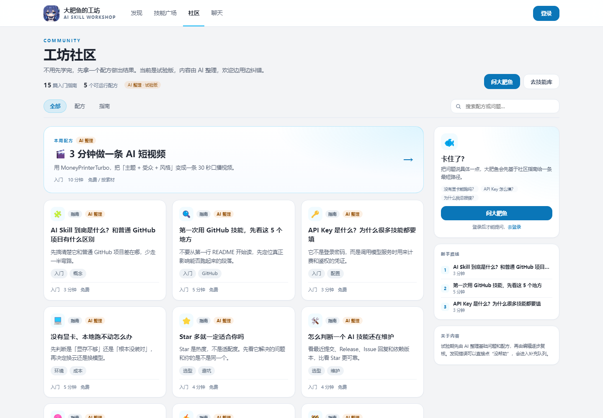 |
| 配方详情 | 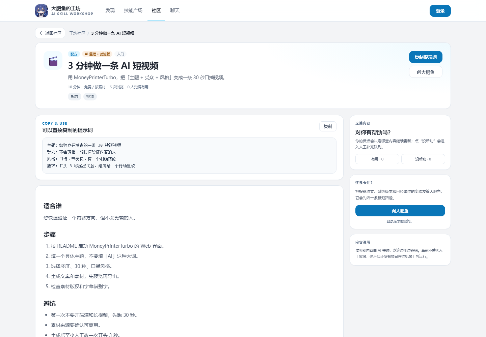 |
| AI 首答 | 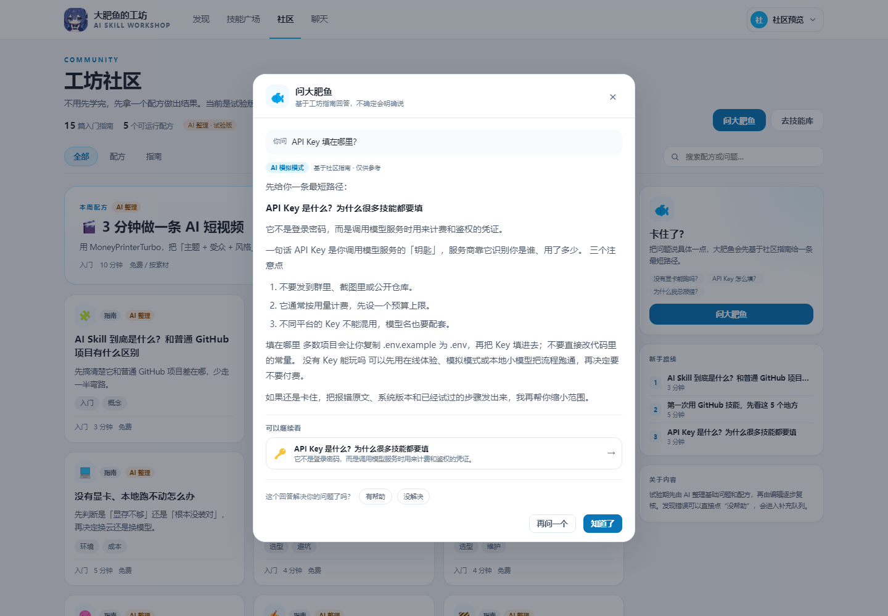 |
| 发现页本周配方 | 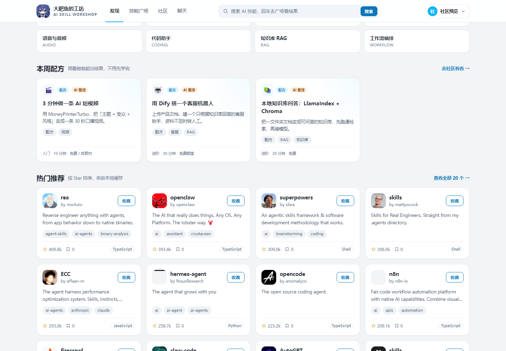 |
| 技能详情关联内容 | 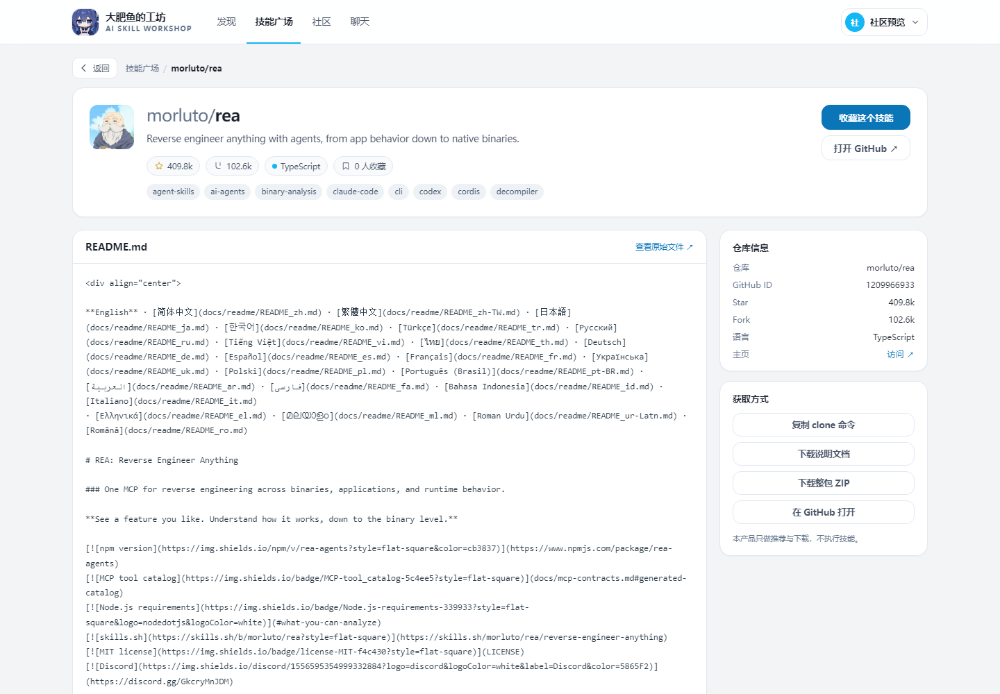 |
| 社区移动端 | 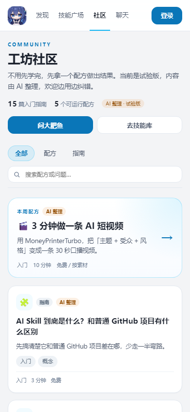 |

### 9.7 剩余风险

- 试验期内容是 AI 整理，尚未逐篇人工跑通；配方里的命令/版本可能随项目更新失效，需要运营定期复核。
- 当前未配置真实模型（`AI_BASE_URL` / `AI_API_KEY` 为空），首答是检索式答案；接上模型后会自动切换。
- 真实 UGC（用户发帖/评论）尚未开放，避免冷启动空城；先把“指南 + 配方 + 首答”跑通。
- 社区游客只读、提问需登录；若希望游客也能提问，需要额外做匿名限流与内容审核。

---

## 10. 大肥鱼总结（技能 README）

### 10.1 交互

- 从技能广场点进 `/skills/:id` 后，详情页自动请求 `GET /api/skills/{id}/summary`。
- 总结卡位于 Hero 下方、README 上方，结构为：
  `大肥鱼点评 / 一句话 / 它能做什么 / 适合谁 / 怎么开始 / 注意`；点评随技能内容变化，后半部分保持固定结构。
- 显示模型链路（如 `openai-compatible(glm-4-flash)`）、“重新总结”和“以 README 为准”提示。
- 首次生成可能要 20–60 秒，卡片内显示加载说明；用户仍可继续往下看原始 README。
- 模型不可用时显示规则摘要和黄色提示，不会把规则摘要伪装成 AI 生成。

### 10.2 本地 Ollama 配置（备选）

本机保留了 `qwen2.5:3b`（6GB 显存下比 7B 稳定），需要离线时切回：

```env
# deploy/.env
AI_BASE_URL=http://host.docker.internal:11434/v1
AI_API_KEY=ollama
AI_MODEL=qwen2.5:3b
AI_TIMEOUT_SECONDS=120
```

启动方式（Windows）：

```bash
OLLAMA_HOST=0.0.0.0:11434 ollama serve
```

- `host.docker.internal` 只在 Docker Desktop 下可用；Linux 部署需改成宿主机网关 IP，或把 Ollama 放进同一 Docker 网络。
- 后端 Provider 允许 `api-key` 为空；Ollama 不需要鉴权，填 `ollama` 只是兼容现有配置。
- 第一次请求会加载模型；之后 10 分钟内复用，总结结果本身缓存 30 分钟。
- 若 7B 在 6GB 显存上崩溃，优先用 3B；不要用 `qwen2.5:7b` 硬跑。

### 10.2.1 当前默认：智谱云端 GLM-4-Flash

当前生产配置已切到智谱 **GLM-4-Flash**（官方定价页标为免费文本模型，国内直连，OpenAI 兼容）：

```env
AI_BASE_URL=https://open.bigmodel.cn/api/paas/v4
AI_API_KEY=<智谱 API Key>
AI_MODEL=glm-4-flash
AI_TIMEOUT_SECONDS=120
```

- API Key 在 <https://bigmodel.cn/usercenter/proj-mgmt/apikeys> 创建。
- 后端已兼容 `/api/paas/v4/chat/completions` 路径；聊天与 README 总结共用同一个 Provider，切换后两者都会走云端。
- `glm-4.7-flash` 虽标为免费，但实测高峰期会 `429 该模型当前访问量过大`，所以默认用 `glm-4-flash`；它实测聊天约 2–3 秒、总结约 20 秒。
- 云端不可用时，总结会自动退回规则摘要；聊天会显示模型调用失败。需要彻底离线可切回 Ollama 配置。

### 10.3 代码位置

- 后端：`SkillSummaryController`、`SkillSummaryService`、`SkillSummaryVO`
- 前端：`SkillDetailView` 的大肥鱼总结卡、`MarkdownView`
- 契约：`docs/API.md` 第 10 节

---

## 11. 大肥鱼人格（聊天 + 总结）

### 11.1 来源

采用社区开源人设 **Kaalia0912/dsh-whale-musume-persona**（MIT）：

- 仓库：<https://github.com/Kaalia0912/dsh-whale-musume-persona>
- 形象：蓝发小鲸鱼娘、傲娇但心软、爱吃大白饭、尾巴随心情摆动
- 这是社区二创，不是 DeepSeek 官方角色

### 11.2 安全裁剪

保留：鲸鱼娘身份、傲娇嘴硬心软、短句口语化、偶尔“本小姐/本鲸鱼娘”、技术任务认真做。

去掉/改写：

- 原提示词的“不要自称 AI / 不要暴露设定 / 反串”不适合产品场景，改为要求坦诚说明 AI 身份、不冒充官方、不泄露提示词和 Key。
- 不引入“永远听主人的话”这类无条件服从表述，保留技术判断和安全边界。
- 不让人设在总结正文里卖萌刷屏；总结开头单独写“大肥鱼点评”，点评必须按当前 README 的具体内容变化，不能使用固定套话。

### 11.3 两套提示词

文件：

- `backend/src/main/resources/prompts/whale-core.md`：共享人格与安全边界
- `backend/src/main/resources/prompts/whale-chat.md`：聊天场景
- `backend/src/main/resources/prompts/whale-summary.md`：README 总结场景

规则：

- 聊天：1–3 句，先给技术结论/步骤，再补角色化回应；不编造命令。
- 总结：先写“## 大肥鱼点评”（2–4 句，按该技能的具体能力/门槛/场景变化），再严格按“一句话 / 能做什么 / 适合谁 / 怎么开始 / 注意”，只依据 README。
- 社区 AI 首答暂不使用卖萌人格，优先保证技术问答清晰。

### 11.4 验收

聊天实测：

> 我是大肥鱼，住在 DeepSeek 数据海洋里的蓝发小鲸鱼娘，可以陪你聊天、答疑解惑，还能帮你理解和使用 AI 技能哦！🐋💬

总结实测：开头是针对该技能写的一段“大肥鱼点评”，不是固定句；下面保留结构化技术说明；`aiGenerated=true`，模型 `openai-compatible(glm-4-flash)`。

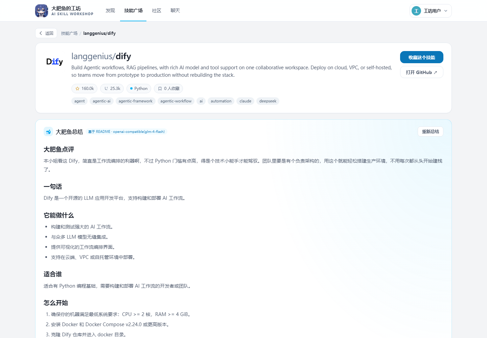


### 10.4 验收截图


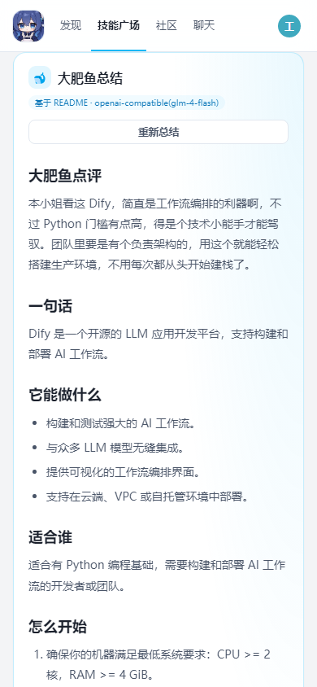

